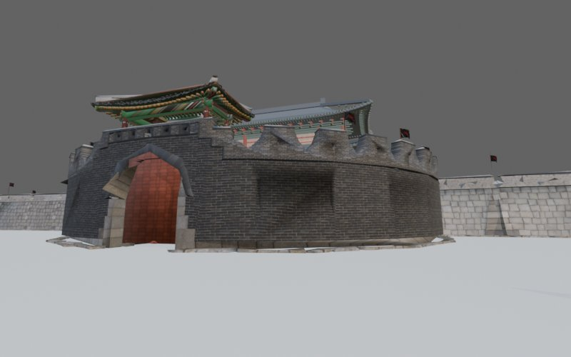
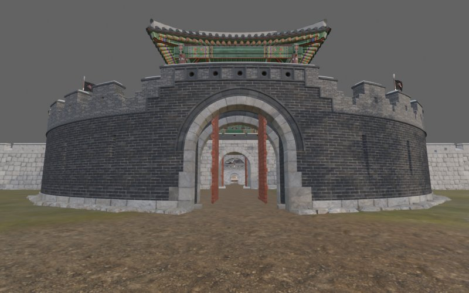
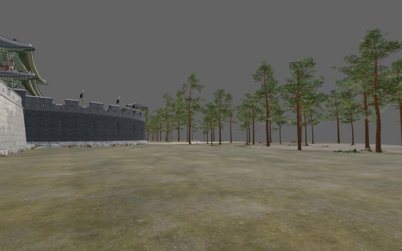
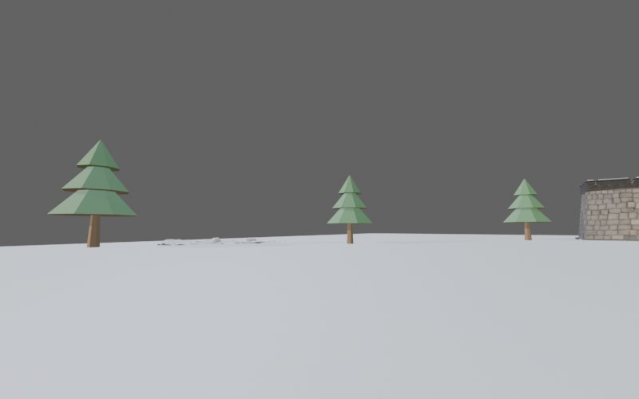

# 수원 화성 — 장안문 아레나 (HWS, v25)

ONLY ONE SHOT 근접전용 소형 맵. 장안문 일곽(문루·육축·옹성)을 중심으로 성벽 ±80 m, 성 안 마당,
성 밖 들판으로 이루어진 140 × 100 m 경기구역. Studio 컨테이너 `Workspace.HWS_Hwaseong` 에 배치·저장돼 있고
문 개폐(`HwsDoorServer`)·점령 구역·스폰·경계까지 Lua 연동이 끝난 상태다. 2026-09-09 ~ 09-12 작업.

| | |
|---|---|
|  |  |
|  |  |

(미리보기는 Blender 단계 렌더. Studio 최종본은 `docs/WORKLOG.md` 의 스크린샷 기록 참고.)

## 폴더

| 경로 | 내용 |
|---|---|
| `docs/WORKLOG.md` | 진행 일지 1~38항. 임포트·배치·충돌·문·점령·이음선 문제의 원인과 처방 전부 |
| `docs/HANDOVER_SPEC.md` | 다른 PC 인계 명세 (좌표 규약, 컨테이너 구성, 힌지 좌표, 함정) |
| `docs/TRANSFER_SPEC.md` | Blender → Studio 이관 명세 (익스포트 세트·배치 JSON 규약) |
| `docs/BLENDER_README.md` | Blender 쪽 작업 기록 (에셋 출처, 1차 배치, 문루 교체, BlenderKit 소품) |
| `scripts/` | Blender 5.2 스크립트. 조립 `assemble_v25.py` / 익스포트 `hws_export.py`·`hws_stage3.py` / 배치 JSON `hws_place.py` / 지형 `terrain6.py`·`rebake_tiles6.py`·`rebake_outer6.py` / 풀 `grass2000.py` |
| `exports/jam/` | KCISA 장안문 재질별 조각 65 (FBX, LFS) |
| `exports/doors/` | 문짝 8 (`HWS_DR4_*`, 닫힌 자세·bbox 중심 원점) |
| `exports/terrain/` | 최종 지형 타일: 안쪽 `HWS_TER6_*` 20 + 외곽 `HWS_OUT6_*` 10 |
| `exports/masters/` | 남한산성 담장·여장·암문 3 + BlenderKit 소품 3 |
| `exports/textures/` | 위 FBX 가 쓰는 텍스처 91장 (PNG, LFS) |
| `placement/` | 배치 JSON: `items_static.json`·`items_doors.json`·`place/`(식생·소품 941)·`collision/`(슬랩)·`grass2000/`(지면 풀 2,000)·`terrain6/`(TER6 위치·보정)·manifest·`scene_dump.json`·`texture_map.json` |

중간 산출물(`_batch*`, `_rebatch_tiles2~5`, 옛 지형 `HWS_TER_*`)과 `.blend` 는 포함하지 않는다.

## 좌표·규약 (산곡 그대로)

- Blender(m) → 엔진(cm): `X = x·100 − 58000`, `Y = z·100`, `Z = −y·100`. 정적물 orientation `(0, −180, 0)`.
- 장안문 문루 중심 = (−58000, 0, 0). 성 밖(옹성 쪽) = +Z. 경기구역 X −67000..−49000, Z ±6500.
- Studio 는 FBX 오브젝트 변환을 무시한다 → `matrix_world` 를 정점에 굽고 항등으로 내보낸다.
- 충돌은 투명 Part 슬랩(`COL_HWS_*`, Block·두께 40·윗면 −30 cm)이 담당. 지형 메시는 CanCollide=false.

## 이번 맵에서 배운 것 (WORKLOG 요약)

- **판형 메시가 안 보이면 위치가 아니라 컬링** — `DoubleSided=true`. 문짝을 네 번 재익스포트하고 나서야 알았다.
- **움직일 파츠는 Mobility=Movable**, MCP 로 만든 Part 는 Shape 기본값이 Cylinder, Raycast 는 `CanQuery=false` 를 지나간다.
- **타일 이음선**은 텍스처 경계 밝기(처방: UV inset 24·margin 48·월드 연속 베이크)보다 **평평한 지형에서 메시별 음영 차**가 더 컸다.
  최종 처방은 ±15 cm 기복(`terrain6.py`) + 경계 띠에 소형 식물 산포. 산곡과 같은 수준으로 처음부터 하는 것이 왕복을 줄인다.
- MeshId 를 직접 바꾸면 `UnitExtent` 도 같이 갱신해야 한다. 안 하면 세로로 수십만 배 늘어난다.

## 출처

- 장안문 일곽: KCISA 「수원화성_장안문」 스캔 (Sketchfab `kcisameta`, **CC BY 4.0**).
- 담장·여장·암문: 국가유산청 3D 남한산성 (**KOGL 제1유형**, 출처표시).
- 건초·항아리·통: BlenderKit (royalty-free). 소나무·풀·바위: 산곡 마스터 재사용.

관련: 같은 화성의 **팔달문·종로 시가지** 맵(`HS_Paldalmun`)은 별도 진행 중이며 계획은 [`docs/plans/hwaseong-paldalmun-layout.md`](../../docs/plans/hwaseong-paldalmun-layout.md) 에 있다.
