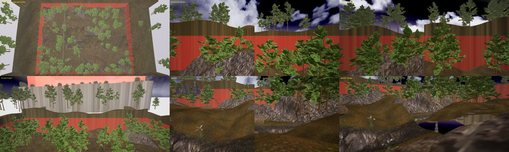
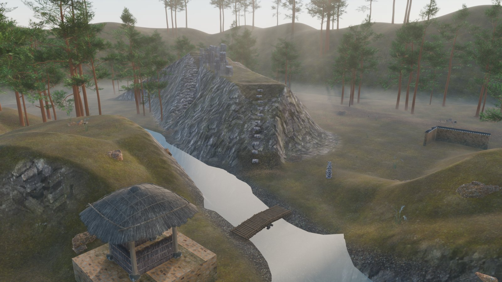

# 산곡 II (SGK_Sangok2)

조선 산곡의 2세대 판. 1세대(`../sangok`, JSN_Sangok)는 2026-09-07 에 레벨에서 내렸고, 투표 로테이션의 "SANGOK" 은 이 맵이다.

160 × 120 m 플레이 구역 + 사방 50 m 산벽. 중앙을 가로지르는 여울·다리·초정(정자)·석축·돌탑, 소나무 453그루와 바위·고사리·억새 552개 인스턴스, 콜리전 Part 2,756장.

| | |
|---|---|
|  |  |

## 구성

- `scripts/` — 레이아웃(해석적 높이함수) → 텍스처 베이크 → FBX 익스포트 → 콜리전 → 배치 JSON → Studio 적용까지 전부 코드. 입구는 `sgk_place.ps1` (`-Check` → `-Snapshot` → GUI 임포트 → `-Resolve` → `-Probe -Apply` → `-Apply` → `-Lua -Apply`).
- `placement/` — 임포트 후 재생성 가능한 배치 산출물: 정적 22 · 인스턴스 552(`place/`) · 콜리전 2,756(`collision/`) · 경계·스폰 · MapService 항목 · 에셋 ID 표.
- `docs/` — 명세·게이트 문서와 **[SESSION_LOG.md](docs/SESSION_LOG.md)** (이관 과정의 실측 기록 1~15절. 삽질과 원인이 전부 여기 있다).
- 바이너리(마스터 `.blend` 48 MB, FBX 43개·아틀라스 666 MB, 트레일러 mp4 77 MB)는 레포에 넣지 않았다. 필요하면 Release 첨부로 받는다.

## 1세대와 달라진 것

- 지형 베이크를 **월드 연속**으로(타일별 시드·노멀·패딩 없는 UV가 이음선의 베이크 쪽 원인이었다) → `sgk_texbake.py`, `sgk_export.py`.
- 잎 카드는 **실루엣 컷 + 투명영역 인필**. OVERDARE 는 텍스처 알파를 아예 쓰지 않는다.
- 배치 좌표는 **오른손 매핑 `(x, z, −y)` + 모든 MeshPart yaw +180°**. Studio 가 임포트 메시를 Y축 180° 돌려 그린다. 1세대의 `(x, z, +y)` 는 거울상이라 타일·산벽이 제자리에서 뒤집혀 보였다.
- 콜리전은 산벽 띠까지, 나무 줄기·바위 전부 박스. 세계 끝 차단벽은 모바일에서 흰 리본으로 보여 뺐다.
- 맵 중심 `X −300 m, Z −400 m`. 모바일 렌더러는 월드 ±1 km 밖을 그리지 않아 −1000 m 자리는 쓸 수 없었다.

규칙과 함정의 일반화는 [overdare-map-pipeline/docs/LESSONS_SANGOK2.md](https://github.com/ShootTheMoon/overdare-map-pipeline/blob/main/docs/LESSONS_SANGOK2.md).

## 소스

국가유산청 3D(KOGL 제1유형) 주상절리·식생, Poly Haven 고사리·텍스처, 소쇄원 초정·담장(별도 PC 보관). 소나무는 Sketchfab CC-BY 팩(밑동 −0.7~1.0 m 묻어서 배치).
